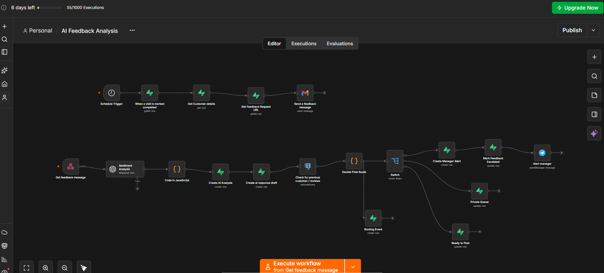

# ai-customer-feedback

## n8n Workflow

The n8n automation connects completed service visits to customer feedback collection and management follow-up.

The workflow covers feedback request emails, AI sentiment and severity analysis, customer history checks, routing decisions, manager alerts, private queue handling, and status updates.
